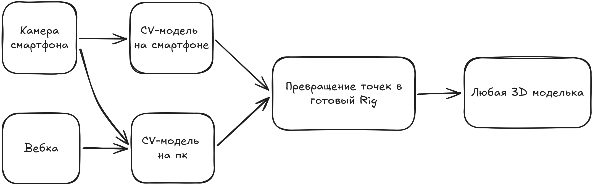

# Motion bridge - обзор системы

Высокопроизводительный кросс-модельный мост для захвата движений в реальном времени. За основу взята идея захвата движений через нейросети. Система забирает готовые точки и пересчитывает их во вращения костей отдавая готовый Rig для разных игровых движков с минимальной задержкой.

## 1. Архитектура и поток данных

Система разделена на три изолированных узла связанных бинарным контрактом:

- **Core** - вычислительное ядро, асинхронный сервер на Rust. Принимает координаты с узла захвата, калибрует и пересчитывает позиции точек в кватернионы, после чего транслирует готовый скелет в приёмник игрового движка.
- **Capture** - узел захвата. Точки тела через CV-модели, приводятся к внутреннему контракту и отправляются посредством Protobuf в вычислительное ядро.
- **Engine receiver** - приёмник игрового движка. Декодирует пакеты и применяет кватернионы к костям 3D-модели с учётом инпут-лага при помощи временной метки.

Дополнительно для отладки существует Visualizer, чтобы видеть корректно ли система выстраивает скелет полученный из вычислительного ядра. Работает на основе Engine reciever, но служит только для отладки.

## 2. Топология монорепозитория

- **proto/schema.proto** - единая схема данных, компилируемая под все языки и узлы.
- **core/** - сервер обработки, вычислительное ядро на Rust.
- **capture/web/** - универсальный браузерный клиент захвата на React, TypeScript.
- **receivers/** - примеры интеграции в разных движках.
- **visualizer/** - визуализатор для отладки работы вычислительного ядра.
- **docs/** - архитектурная документация принятых решений.

### Инфраструктура окружения:

- **flake.nix** - декларативное окружение разработки NixOS.
- **mprocs.yaml** - оркестрация параллельного запуска всех узлов одной командой.
- **Caddyfile** - локальный реверс-прокси для защищённого доступа браузера к камере при работе по локальной сети.

## 3. Архитектурные решения и правила

- Отказ от JSON на уровне сетевой передачи в пользу бинарной упаковки данных на основе Protobuf в силу меньшего расхода памяти и большей производительности в рамках высокочастотной передачи кадров.
- Размер одного кадра должен быть менее 1500 байт в рамках ограничения MTU, чтобы исключить фрагментацию кадра в силу использования UDP пакетов в будущем.
- Временная метка timestamp получает своё время при инициализации кадра до его захвата и проходит неизменной через все узлы для компенсации задержек в конечной точке.
- Приоритет на последние кадры. Система работает в реальном времени и должна отбрасывать старые кадры при поступлении новых данных.
- Хранение нескольких кадров. Ядро должно сохранять небольшую историю кадров для сглаживания джиттера получаемого от CV-моделей при нестабильных скачках захваченных точек.

## 4. Сетевая конфигурация

Порты используются для локальной разработки, будут изменены и вынесены в единый конфиг.

- Caddy (HTTPS/WSS): порт **8443**.
- Caddy redirect (HTTP): порт **8080**, перенаправляет на порт **8443**.
- Web Client отдаёт статику, корректное перенаправление получает от Caddy с порта **8443** на порт **5173**.
- Rust Core WebSocket принимает поток от клиента захвата, корректое перенаправление получает от Caddy с порта **8443** на порт **3000**.
- Rust Core -> Engine Reciever: порт **4242**.

## 5. Текущий фокус: 0.1.0-alpha

Главная цель текущего этапа - замкнуть сквозной базовый цикл.

Модель захватывает данные и передает их в вычислительное ядро. Ядро выстраивает готовый скелет и отправляет его по UDP. Приёмник получает готовые кости и применяет их к визуализации 3D-модели.
